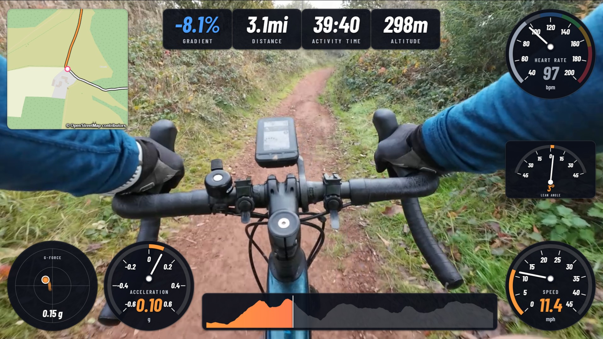
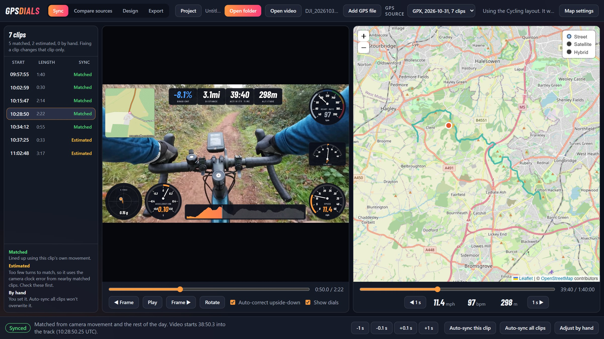
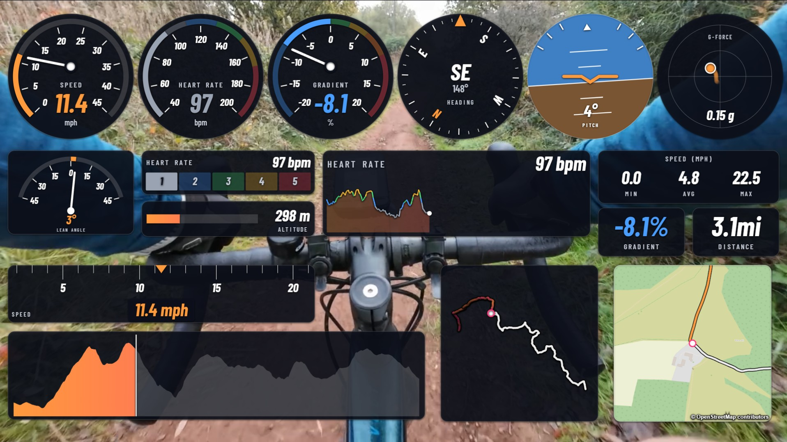
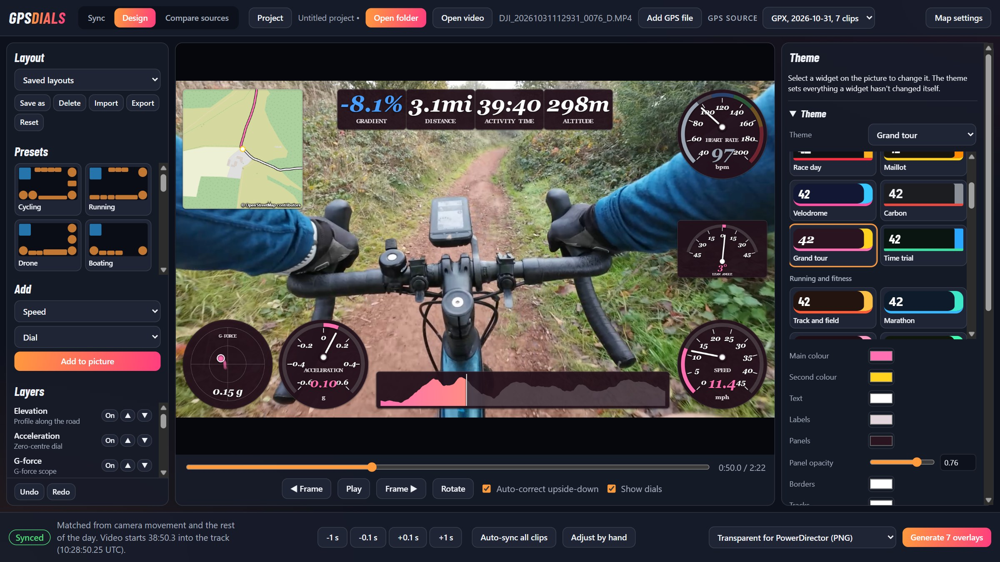
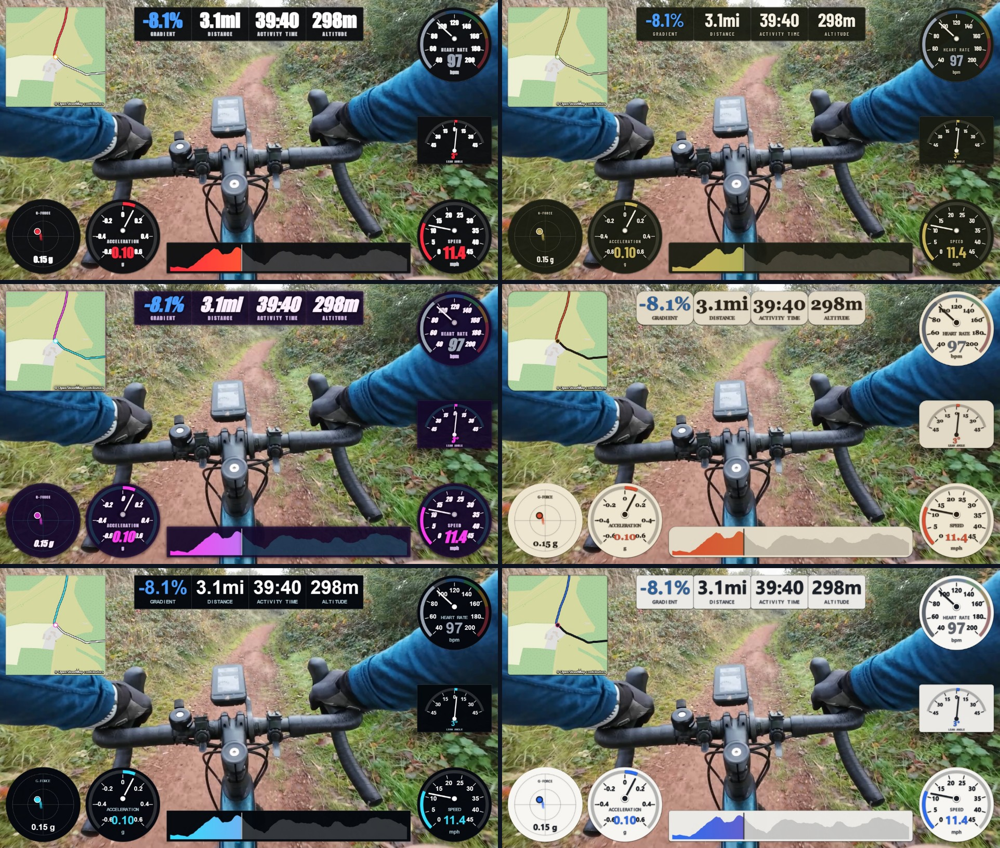
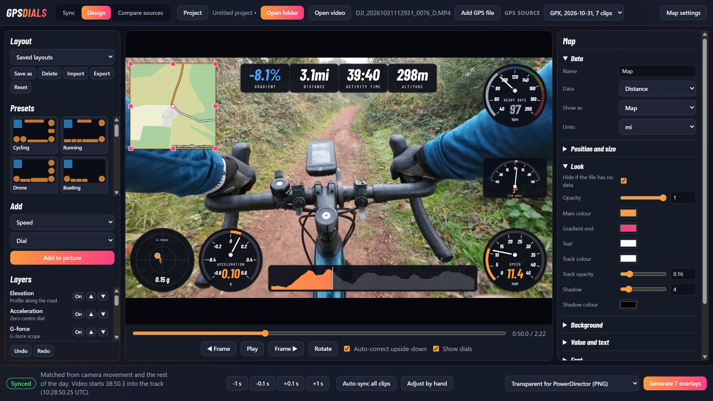
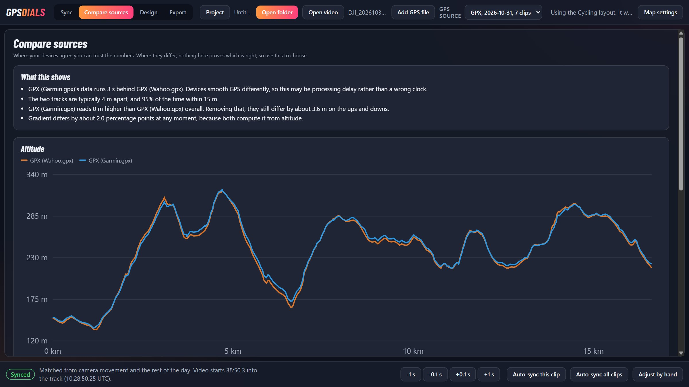
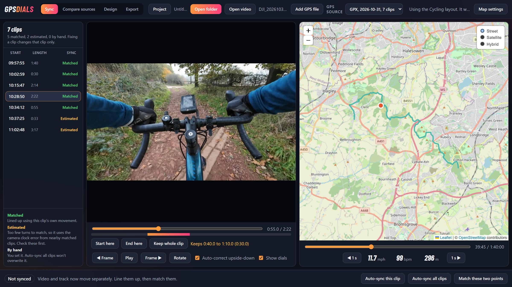

# gps-dials

Free, open-source telemetry overlays for action camera footage: speed, heart rate, gradient, maps and more, lined up automatically with your GPS data.



It is a community successor to Garmin VIRB Edit, which Garmin no longer develops. The app imports your clips and FIT or GPX files, syncs them, lets you lay out dials on a WYSIWYG canvas and exports an overlay for your video editor: true transparency (alpha) for editors that support it, or a chroma key background for those that don't.

> **Status: early but working.** Sync, the layout editor, source comparison and overlay export all work. Expect rough edges, and tell us what you find.

## Download

Get the latest version from the [Releases page](https://github.com/dirk1978/gps-dials/releases). Everything it needs is included, so there's nothing else to install.

| System | File |
|---|---|
| Windows 10 or 11 (64-bit) | `.exe` installer |
| macOS on Apple silicon | `.dmg` |
| Linux | `.AppImage` or `.deb` |

The downloads aren't commercially code-signed yet, so your system will warn you. On Windows, choose **More info**, then **Run anyway**. On a Mac, right-click the app and choose **Open**, or allow it under **Privacy & Security** in System Settings.

## The workflow

1. Copy a day's videos and FIT files into a folder and open it. You can also open one video, and the app looks in its folder for the FIT or GPX file that matches.
2. The app finds the matching activity and syncs every clip.
3. Check each clip beside the map and correct any that are off.
4. On the **Export** tab, make a finished video, or generate one overlay file per video for your editor, in an `overlays` folder beside your clips. Each overlay is named after its clip and fits it exactly, so it drops straight onto the track above it.



| Format | Best for | Size at 4K |
|---|---|---|
| Transparent (PNG in MOV) | PowerDirector | About 0.3 GB a minute |
| Transparent (ProRes 4444) | Resolve, Premiere, Final Cut | About 0.5 GB a minute |
| Green screen (H.264) | Any editor with a chroma key | About 4 MB a minute |

Transparent overlays run at 10 frames a second, the rate the dials update, which editors place correctly by time. Storing every frame would make them five times larger.

## Export a finished video

Everything leaves the app from the **Export** tab, as overlay files for your editor or a finished video. Don't want another editor in the way? Choose a finished video and the app trims and joins your clips, burns the dials in and writes an MP4, using your GPU where it can.

- **Trim:** go to a point in a clip and press **Start here** or **End here**, and untick any clips you don't want.
- **Frame shape:** keep the original, or crop to 16:9, 9:16, 1:1, 4:5, 4:3 or 21:9, and slide the crop to frame the shot. Dials are placed in the cropped frame, so nothing gets cut off, and the Design tab shows the same shape.
- **Quality:** choose the resolution, frame rate, format (H.264, H.265 or AV1, where your PC can write them) and data rate, or keep them the same as the video.
- **Output:** one joined video or one per clip, with or without the sound.

HDR footage comes out as standard dynamic range.

## Design your own overlay

The **Design** tab works straight on top of your footage. Any data can be shown any way:


- **Data:** speed, average and top speed, pace, heart rate, cadence, power, zones, temperature, altitude, gradient, climbing, climb rate, heading, distance, progress, coordinates, time and date.
- **Forces:** lean angle, pitch, G-force, acceleration, cornering force and corner speed.
- **Timing:** laps from your device, kilometre and mile splits, and a standing start timer to a speed you choose.
- **Camera:** ISO, shutter speed, aperture and white balance.
- **Displays:** dial, zero-centre dial, arc, compass, sliding tape, tilt indicator, artificial horizon, G-force scope, bar, zone blocks, number, min, average and max, graph over time or distance, road profile, map, route and custom text. Your own images can be a logo, a dial and needle, or a picture that fills or grows with the value.



The data lists show what matters for your activity first.

The app recognises cycling, running, drone, boating and flying recordings and starts with a layout to suit. Each gauge has a next best choice, so where your file has no power data, for example, the space shows G-force instead. If you change a layout, the app leaves it as it is. Heart rate and power zones come from your own max heart rate and FTP, set in the Theme panel.

Lean angle and G-force are worked out from GPS, which updates about once a second, so they smooth out quick movements. Where a camera records its own orientation, its reading is used instead. On a helmet, that follows your head rather than the bike. Drones report which way they're pointing, so a drone's compass shows that rather than its direction of travel.

Not sure what's possible? **Load all dials** fills the picture with every gauge your activity and file have data for, as worked examples. Remove the ones you don't want and rearrange the rest, or press Undo to go back.

Start from one of the built-in presets, or from nothing. Drag and resize on the picture, with snapping to the centre and to other widgets. Each widget has its own colours, thickness, size, opacity, fonts, scale, ticks, colour zones and more, and a theme sets everything you haven't changed yourself. More than 40 themes are built in, grouped by activity and feel. Layouts can be saved and shared as files.





## Maps in your overlays

The **Map** display shows your track on a real map, either following you, or fitted to the clip or the whole activity. Choose the zoom, whether it turns with your direction of travel, its shape, opacity, darkness, colour, brightness and contrast, and style the route and position marker however you like.



OpenStreetMap works with no setup. Its credit stays on the map, because that's a condition of using it. The app fetches only the map images each clip needs and keeps them on your PC, as [its tile policy](https://operations.osmfoundation.org/policies/tiles/) asks. Mapbox styles, including satellite, use your own token from **Map settings**, which explains the free allowance and how to get one. Any other provider can be added by its tile address. Check your provider's terms before publishing its maps in video.

## Compare your sources

Recorded the same ride on two devices? The **Compare sources** tab shows where they agree and differ on position, altitude, speed, heart rate and gradient, and can build a combined track from the best of each. An optional check against terrain data sends your route to [Open-Meteo](https://open-meteo.com/) only when you press its button. Terrain data comes from the Copernicus GLO-90 elevation model.



## Projects

The **Project** menu keeps a piece of work together: your clips, GPS sources, sync, corrections, rotations and layout. Save a project, close it, start a new one, and open it again later. The project file only points to your videos, so they stay where they are, and the app tells you if any have moved.

## What works today

Sync finds where a clip belongs in an activity by comparing the camera's turning with the turns in the GPS track, so it does not depend on the camera's clock being right. A camera's clock is wrong by about the same amount all day, so clips that match well also settle the short or straight clips that can't be matched alone.

Clips can also be lined up by hand: find a frame you recognise, click that spot on the track and match them. The track still works if map images can't load.



Previews and green screen exports use the GPU when they can. NVIDIA is tested; Intel, AMD and Apple are built in but not yet tested on real hardware, and anything else falls back to the CPU.

To run from source instead, you need [Node.js](https://nodejs.org/) 24 or later and [FFmpeg](https://ffmpeg.org/) on your PATH.

```bash
npm install
npm run app
```

There is also a command-line version for one clip. Use `--device <id>` to choose a device instead of detecting it.

```bash
npm run sync -- path/to/clip.mp4 path/to/activity.fit
```

## Supported devices

| Device | Motion data | Camera data | Status |
|---|---|---|---|
| DJI Osmo Action 4 | Orientation track, plus vibration | Lean, pitch, ISO, shutter, white balance | Tested on a 72-clip ride, with Garmin and Wahoo tracks |
| DJI Neo | Its own GPS track, so sync is exact | Heading, roll, pitch, ISO, shutter, aperture, white balance | Tested on one flight, with and without its `.SRT` file |
| Insta360 GO 3 | Picture motion | Shutter | Tested on one 26-minute clip |
| GoPro (HERO5 Black and later) | GPS time, so sync is exact where the clip has a fix. Otherwise its gyro | ISO, shutter, white balance | Built from GoPro's published format; not yet tested on real footage |
| Other DJI cameras | The Action 4's orientation track if it fits, otherwise picture motion | Settings where the layout matches | Should work; not tested |
| Other Insta360 cameras | Picture motion | Shutter | Should work; not tested |
| iPhone, Android and anything else | Picture motion | None | Should work; not tested. Best when the phone is mounted, because picture motion follows the phone rather than the route |

GoPro models without GPS, such as the HERO12 Black, use their gyro instead. Lean angle and pitch on a GoPro come from GPS, as they do for other cameras without an orientation reading. Long GoPro recordings split into chapters are treated as separate clips.

| Track format | Status |
|---|---|
| FIT, including laps | Supported |
| DJI `.SRT` | Supported |
| GPS inside a DJI Neo or GoPro video | Supported |
| GPX, including heart rate, cadence and power | Supported |

## Add your camera

Device support is built by the community, and each device is one small file. See [CONTRIBUTING.md](CONTRIBUTING.md).

## Licence

[MIT](LICENSE). The Barlow Condensed typeface is used under the SIL Open Font License. The downloads include FFmpeg as a separate program under the GPL, with its licence alongside it. Its source is available from [FFmpeg](https://ffmpeg.org/download.html#get-sources), and the builds come from [BtbN](https://github.com/BtbN/FFmpeg-Builds) and [ffmpeg-static](https://github.com/eugeneware/ffmpeg-static). This project is not affiliated with Garmin, DJI, Insta360 or Wahoo.
